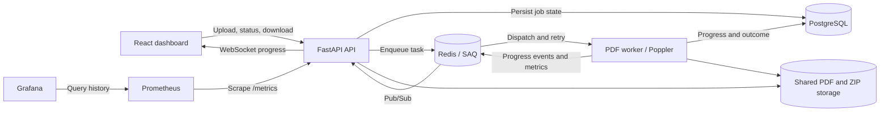
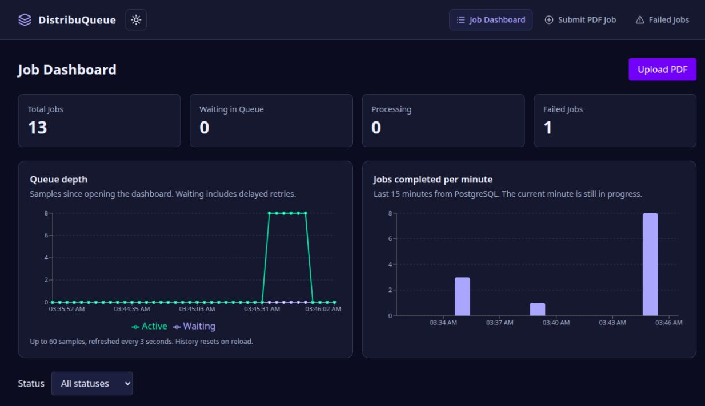

# DistribuQueue — Distributed PDF Task Queue

Upload PDFs, render pages in background workers, track live progress, and download the results as ZIPs. Built with FastAPI, PostgreSQL, Redis-backed SAQ, and React.

## Architecture



Uploads return after the input and durable delivery intent are saved; PDF rendering runs in a separate worker process. PostgreSQL is the source of job state, Redis handles dispatch and live notifications, and the shared Docker volume holds original PDFs and rendered ZIPs.

## One-command setup

Requires Docker with Docker Compose. From a fresh checkout, start the full app and monitoring:

```bash
docker compose -f docker-compose.yml -f docker-compose.monitoring.yml up --build -d
```

Open **http://localhost:3000**. API docs: http://localhost:8001/docs. Grafana: http://localhost:3001 (initially `admin` / `admin`). Defaults work without an `.env` file; existing PostgreSQL volumes require their existing password. Port conflicts and development setup are covered [below](#run-locally-with-docker).

## Benchmark results and limits

| Recorded local check | Result |
| --- | --- |
| Load | 40 synthetic two-page PDFs in **21.78 seconds — 1.84 jobs/second** |
| Output validation | 40/40 ZIPs passed integrity, page-count, and PNG-signature checks |
| Worker SIGKILL | 4/4 interrupted ten-page jobs recovered with valid ZIPs in **88.17 seconds** |

**Conditions:** one worker limited to **2 CPUs / 1 GiB**, concurrency 10, and eight concurrent upload requests. These were simple generated PDFs in one finite batch on a shared laptop, not sustained production capacity. The crash test retained Redis, PostgreSQL, and storage and used a **30-second task timeout**; the application default is **1800 seconds**. It does not establish exactly-once execution or guaranteed zero job loss.

[Full methodology and reproduction](docs/benchmarks/README.md) · [Raw measurements](docs/benchmarks/latest.json)

## Design decisions

- **PostgreSQL owns job state and delivery intent.** A dispatch marker is committed with the job; the API retries Redis delivery after a crash or temporary outage. The shared SAQ key suppresses incomplete duplicate deliveries, without claiming a transaction spanning PostgreSQL and Redis.
- **Use database constraints and row locks for concurrency.** `ON CONFLICT` resolves simultaneous uploads using one idempotency key; row locks serialize requeue, worker receipt, and deletion claims.
- **Persist progress before publishing it.** Redis Pub/Sub and WebSockets provide live updates; reconnect and REST polling recover missed notifications. Pub/Sub is not a durable event log.
- **Keep v1 on one Docker host.** API and workers share a file volume, with SAQ supplying retries/backoff and Prometheus/Grafana supplying monitoring. Multiple hosts need shared/object storage; cloud/Kubernetes deployment is deferred to v2.

## Demo



[60-second screenshot walkthrough](docs/demo/walkthrough.mp4) · [GIF preview](docs/demo/preview.gif) · [Screenshots](docs/demo/README.md) · [Resume and interview notes](docs/portfolio.md)

**Local v1 is feature-complete.** Latest backend validation: 76 passing tests. The sections below document operation and known limits.

## Stack

| Layer | Technology |
| --- | --- |
| API and persistence | Python 3.12, FastAPI, SQLModel, async SQLAlchemy, PostgreSQL, Alembic |
| Background processing | Redis, SAQ, Poppler |
| Dashboard | React, TypeScript, Vite, TanStack Query, Tailwind CSS, Recharts |
| Monitoring | Prometheus, Grafana |
| Delivery and verification | Docker Compose, GitHub Actions, pytest, Black, Oxlint |

## What this demonstrates

- Separating request handling from background execution, with a persistent job lifecycle.
- Database-enforced idempotency for repeated and simultaneous submissions, bounded retries with jitter, and manual recovery of failed jobs.
- Redis Pub/Sub and WebSockets for live progress, with reconnect and REST polling when connections drop.
- Database migrations, container networking, shared storage, and independent API/worker processes.
- Request latency, queue depth, attempt outcomes, and processing-time measurements across processes.

This is a working portfolio project, with explicit reliability limits listed below. It does not claim exactly-once processing or measured production-scale throughput.

## Run locally with Docker

Requires Docker and Docker Compose. From the repository root:

```bash
[ -f .env ] || cp .env.example .env
docker compose up --build -d
```

Open http://localhost:3000, choose a PDF, and select **Upload and Render**. The dashboard lists jobs newest first, with status filters and pagination. The **Failed Jobs** view includes errors and retry controls. The responsive dashboard includes a persisted light/dark theme switch. The job page receives WebSocket progress, reconnects automatically, and polls every second during disconnection (every five seconds while connected to recover missed notifications) and offers a ZIP download when processing completes. API documentation is available at http://localhost:8001/docs.

For an existing PostgreSQL volume, set `POSTGRES_PASSWORD` in `.env` to its existing password. PostgreSQL initialization variables do not change credentials in an already-initialized volume. The API uses host port 8001; its internal Docker port remains 8000.

The Docker image installs Poppler (`pdfinfo` and `pdftoppm`). API and worker containers share the `job_files` volume, so uploads and results survive container restarts. API processes run as a non-root user.

The frontend image builds React using Node.js and serves the result from an unprivileged Nginx container. API requests and WebSockets are proxied through the dashboard's own address. The worker and frontend wait for the API healthcheck, after startup migrations finish. Browser routes also work when opened directly or refreshed.

If port 3000 is occupied, set `FRONTEND_PORT=3002` in `.env` and open http://localhost:3002. For frontend development with live reload, use Node.js 22 and run:

```bash
docker compose up --build -d api worker
cd frontend
npm ci
npm run dev
```

Stop the Docker frontend with `docker compose stop frontend` before running Vite on the same port.

For running the API/worker outside Docker, install `poppler-utils`, install Python dependencies, and configure the individual PostgreSQL and Redis variables in `.env` for your local services. Set `STORAGE_DIR` to the same directory for both processes.

## Processing behavior

- Accepts PDFs up to 20 MiB and 50 pages by default; encrypted PDFs are unsupported.
- Renders each page with a maximum dimension of 1600 pixels. Progress advances as pages finish; 100% means the ZIP is ready.
- Rejects empty uploads, non-PDF headers, invalid extensions, and oversized uploads. Malformed PDFs fail during processing and use the normal retry/failed-job flow.
- `max_retries` is the maximum **total attempts**, including the first attempt. A value of 3 permits an initial attempt and two retries. Manual requeue resets this budget and progress.
- Automatic retries use exponential backoff with jitter: default windows are 2, 4, 8 seconds, doubling up to a 60-second cap. SAQ chooses a random delay within each window. Configure `RETRY_BASE_DELAY` and `RETRY_MAX_DELAY` in seconds; both must be positive. The worker scheduler dispatches due retries, so actual start times may be slightly later. Manual requeue starts a fresh immediate attempt.
- Uses job IDs for storage paths; original upload names are display metadata. Rendering subprocesses have a 30-second timeout each.
- A failed Redis progress notification is logged; it does not change the persisted task outcome. The polling UI can still retrieve the state.

## Durable queue delivery

Each upload or manual requeue saves a unique delivery key and a pending-delivery marker in the same PostgreSQL transaction as the job state. The API tries immediate delivery to SAQ; its background dispatcher also checks committed markers every two seconds, including after API restart. Redis outages leave accepted jobs `PENDING` for automatic delivery rather than moving them into the failed-job list. Uploads return HTTP 201 and requeues return HTTP 200 once their intent is saved, even when Redis is temporarily unavailable.

Delivery uses the same SAQ key until acknowledged. A worker receipt clears the marker before rendering; completed/failed jobs and tasks from older requeue generations are not rendered again. PostgreSQL row locks serialize delivery claims and manual requeues. This closes the API-crash gap between saving a job and enqueueing it; it does not provide exactly-once execution or recover work lost after an acknowledged delivery if Redis loses its data. Worker interruption handling is described below; storage cleanup remains separate work.

The API must remain running for automatic dispatch retries. The migration preserves existing jobs without replaying them; legacy stranded jobs require inspection and explicit recovery.

## Worker interruption recovery

The worker reconciles PostgreSQL with SAQ after each attempt. A cancelled/timed-out render becomes `PENDING` when SAQ has scheduled another attempt, or `FAILED` when its budget is exhausted. Attempts lost to a worker crash count toward the same budget when a later attempt starts. Graceful worker cancellation also updates the persisted state.

For a worker killed without cleanup, a running SAQ worker's sweeper detects stuck tasks using their configured timeout (currently 1800 seconds), then retries or aborts them. The API recovery loop reflects that broker decision in PostgreSQL every two seconds. Detection is not immediate, and requires a running worker/sweeper and API. Recovery refreshes the broker record under a database row lock and ignores older dispatch generations.

Missing Redis records are left unchanged rather than treated as proof of failure. SAQ terminal records currently expire after 600 seconds; recovery after Redis data loss or prolonged downtime beyond that retention still needs explicit investigation. This does not guarantee exactly-once execution. Reconciled terminal failures are counted without fabricating a processing duration for a killed process.

## Deleting jobs and saved files

Completed and failed job pages offer **Delete job and files**, with confirmation. Deletion removes the original PDF, rendered ZIP, leftover scratch files, and job metadata. Pending/processing jobs cannot be deleted (HTTP 409). Requeue and deletion use the same database row lock so a claimed requeue cannot lose its input to a concurrent delete.

The API first commits a deletion marker, hides the job from lists/status/downloads, then removes its job directory and database row. Storage failures return HTTP 202; the background loop retries cleanup, including after restart. Crashes after file removal leave the marker available for another pass. Permanent storage permission failures need correction before cleanup can succeed. No age-based retention policy is enabled.

Deleting a job also removes its idempotency-key claim once cleanup finishes; the key may then be reused. PostgreSQL dashboard counts represent retained jobs. Historical Prometheus measurements remain; SAQ's task record expires through its normal retention. The frontend clears that job's cached status and returns to the dashboard. Theme preferences are unaffected.

## Dashboard metrics and notifications

`/jobs/stats` returns an atomic Redis snapshot (ready, active, and delayed jobs), a waiting depth (ready + delayed), and completed-job counts per minute for the last 15 minutes from PostgreSQL. Unavailable queue metrics are returned as `null` with an error message; they are never displayed as a false zero.

The queue chart keeps up to 60 samples in the current browser session, sampled every three seconds while the dashboard is open. History resets on reload; it is not persisted monitoring history. The completion chart includes the current, partial minute. Completion/failure notifications appear when a watched job changes from a non-terminal state, using the existing live progress cache and polling fallback. Opening an already-finished job does not produce a new notification.

## Prometheus and Grafana

Start the app plus monitoring:

```bash
docker compose -f docker-compose.yml -f docker-compose.monitoring.yml up --build -d
```

- Grafana: http://localhost:3001, initially `admin` / `admin`. Set `GRAFANA_ADMIN_PASSWORD` in `.env` before the first start to choose a different initial password.
- Prometheus: http://localhost:9090.
- Raw API metrics: http://localhost:8001/metrics.

The Prometheus data source and **DistribuQueue Overview** dashboard are provisioned automatically. Prometheus scrapes every 5 seconds and retains 7 days of history in its Docker volume. Grafana settings also use a persistent volume. Monitoring ports bind to localhost. Rate/percentile panels need multiple scrapes and some activity; an idle window may show no data.

API instrumentation exports request counts and latency histograms by route template. Workers aggregate attempt counts, processing-time histograms, and terminal failures in Redis; the API exports the shared totals, so measurements include separate worker processes. Queue gauges report ready, active, and delayed jobs. Retries are separate attempts; durations exclude queue wait and retry delay. A failed/cancelled attempt differs from a terminal failure that exhausts the retry budget.

Worker metrics are best effort. Failed metrics writes do not fail a successful render. If Redis cannot be scraped, `/metrics` reports `dtq_redis_metrics_available=0` and omits worker/queue values instead of inventing zeros. Redis counter totals reset if its data is lost; historical samples remain in Prometheus. The supplied setup uses one API exporter; if you scale API replicas, scrape one designated exporter for shared Redis totals to avoid double-counting them.

## API

- `POST /api/v1/jobs/upload`: multipart fields `file`, optional `max_retries` and `idempotency_key`.
- `GET /api/v1/jobs?page=1&page_size=20&status=FAILED`: paginated list; status is optional and page size is capped at 100.
- `GET /api/v1/jobs/{id}`: job state and progress.
- `GET /api/v1/jobs/{id}/result`: ZIP download for a completed job.
- `GET /api/v1/jobs/{id}/ws`: WebSocket progress events.
- `GET /api/v1/jobs/stats`: job counts.
- `GET /api/v1/jobs/dlq`: failed jobs.
- `POST /api/v1/jobs/{id}/requeue`: retry a failed job using its saved input.
- `DELETE /api/v1/jobs/{id}`: delete a completed/failed job and its saved files; HTTP 200 when cleaned, or 202 with `cleanup_pending=true` when cleanup will retry.

### Try the API

Submit a PDF (replace the file path):

```bash
curl --fail-with-body -X POST http://localhost:8001/api/v1/jobs/upload \
  -F 'file=@sample.pdf;type=application/pdf' \
  -F 'max_retries=3' \
  -F 'idempotency_key=demo-upload-001'
```

Use the returned job ID in place of `123`:

```bash
curl --fail-with-body http://localhost:8001/api/v1/jobs/123
# After the status becomes COMPLETED:
curl --fail-with-body http://localhost:8001/api/v1/jobs/123/result -o pages.zip
# For a FAILED job:
curl --fail-with-body -X POST http://localhost:8001/api/v1/jobs/123/requeue
```

Reusing an idempotency key returns the existing job; use a new key for a new upload. Interactive API documentation is at [Swagger UI](http://localhost:8001/docs).

Filename-only JSON submissions are no longer supported. Jobs created before file uploads were added have no PDF input and must be submitted again through the upload form.

## Validation and remaining scope

Backend tests use real PDFs, Poppler, PostgreSQL, Redis, and SAQ, including upload-to-download, retry exhaustion, idempotent submission, and WebSocket delivery. Test fixtures create and drop tables: use a disposable test database. GitHub Actions runs separate backend and frontend checks on pushes and pull requests to `main`. Backend checks validate the Poetry lockfile, Black formatting, the migration lifecycle, and pytest using isolated PostgreSQL/Redis services and Poppler. Frontend checks install with `npm ci`, lint with Oxlint, and typecheck/build with TypeScript and Vite.

The migration checker creates a new database whose name ends in `_migrations`, tests upgrade → full rollback → upgrade, and verifies the current Job model can insert into the migrated schema. It refuses existing databases. Pytest uses a separate database because its fixtures create/drop tables. These checks do not publish images or deploy to a cloud provider.

Remaining work includes authentication, age-based storage retention, recovery after Redis data loss or expired queue records. Shared disk storage supports multiple workers on one Docker host; workers on separate machines need shared/object storage. Prometheus/Grafana monitoring is included; no Kubernetes deployment is implemented. Recorded local load/crash measurements are linked below.

## v1 finish line

This release is a local portfolio demo. The recorded load/crash check and the demo/screenshots/resume material are complete. The feature scope is frozen; remaining publication is committing and pushing the final documentation/media. The core upload, queue, render, download, monitoring, and deletion flows must keep passing CI. Simultaneous uploads using one idempotency key must return the same job and create only one input file and queue task.

Cloud deployment, Kubernetes/KEDA autoscaling, full authentication, and age-based retention remain future v2 work. The first v2 change adds opt-in object storage; see the setup and migration limits below. They are not prerequisites for completing this release. The current app is intended for local demonstration, not an unrestricted public upload service. Performance claims must name the tested workload and environment. The measured results above apply only to their documented conditions.

## Deployment status

Docker Compose runs the frontend, backend, and optional monitoring on one machine. Vite remains available for frontend development. GitHub Actions validates backend code, migrations, and the frontend build; it does not publish images or perform deployment. Terraform, AWS infrastructure, Kubernetes, and automated cloud delivery are not implemented.

Multiple workers can share the volume on one Docker host. A multi-host deployment needs shared/object storage, an explicit migration strategy, and recovery guarantees before it can be presented as production ready.

## Demo and presentation

The [demo asset index](docs/demo/README.md) contains actual screenshots of submission, live processing, completion, failed-job management, and Grafana. The [60-second walkthrough](docs/demo/walkthrough.mp4) is an edited screenshot sequence with synthetic inputs. A real browser upload completed and its downloaded ZIP was verified to contain 30 PNG pages.

Use the [portfolio notes](docs/portfolio.md) for concise resume bullets, the idempotency-race story, and explanations of durable dispatch, worker recovery, deletion, and their limits.

## v2 shared storage (opt-in)

MinIO-backed uploads and results are available through an optional Compose overlay.
See [shared storage setup and limits](docs/shared-storage.md) before switching any existing demo.

A [two-worker shared-storage verification](docs/benchmarks/shared-workers.md) checks independent worker participation and survivor-only recovery after SIGKILL.
