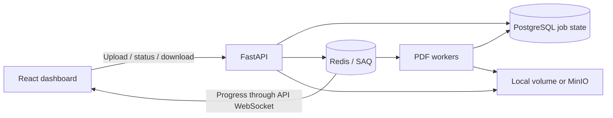

# DistribuQueue - Distributed PDF Task Queue

Upload a PDF, watch its pages render in background workers, and download the results as a ZIP. A React dashboard connects the full workflow, from submission to retries and live progress.

**React/TypeScript · FastAPI · PostgreSQL · Redis/SAQ · Docker**

[Demo walkthrough](docs/demo/walkthrough.mp4) · [Screenshots](docs/demo/README.md) · [Architecture and operations](docs/operations.md) · [CI](https://github.com/ahmedforge/distributed-task-queue/actions)


## Try it locally

Requires Docker with Docker Compose. From a fresh checkout:

```bash
git clone https://github.com/ahmedforge/distributed-task-queue.git
cd distributed-task-queue
docker compose -f docker-compose.yml -f docker-compose.monitoring.yml up --build -d
```

Open **http://localhost:3000**, choose a PDF, and select **Upload and Render**. Follow its progress, then download the ZIP. API docs: http://localhost:8001/docs. Grafana: http://localhost:3001 (initial local login: `admin` / `admin`).

Defaults work without an `.env` file. Existing PostgreSQL volumes require their existing password. See [development setup and port configuration](docs/operations.md#run-locally-with-docker).

## What this demonstrates

- **Full-stack workflow:** upload validation, a paginated dashboard, failed-job management, live WebSocket progress with polling fallback, and ZIP downloads.
- **Persistent job lifecycle:** PostgreSQL owns job state and dispatch intent; a recovery loop retries delivery when Redis is temporarily unavailable.
- **Concurrency and recovery:** database-enforced submission idempotency, row locks for requeue/deletion, bounded retries with jitter, and interrupted-worker reconciliation.
- **Observable execution:** Prometheus metrics and a provisioned Grafana dashboard cover API latency, queue depth, and worker outcomes.
- **Optional infrastructure:** MinIO shared storage and a local Kubernetes/KEDA demo, with Terraform setup and versioned GHCR images.



[Detailed architecture and design decisions](docs/operations.md#design-decisions)

## Recorded verification

| Local check | Recorded result |
| --- | --- |
| Finite load batch | 40 synthetic two-page PDFs in 21.78 seconds; all 40 ZIPs validated |
| Worker interruption | All four interrupted ten-page jobs recovered with valid ZIPs |
| Optional local KEDA demo | Workers scaled 1 → 3 → 1; all 16 twenty-page PDFs completed |

The batch used one worker limited to 2 CPUs / 1 GiB. The crash check retained Redis, PostgreSQL, and storage, and used a 30-second task timeout rather than the 1800-second default. These are bounded local observations, not sustained production capacity or exactly-once guarantees.

[Benchmark methodology and raw results](docs/benchmarks/README.md) · [KEDA verification](docs/kubernetes.md#recorded-verification)

## Engineering details

- [API, processing behavior, retries, and recovery](docs/operations.md#api)
- [Backend/frontend validation and CI](docs/operations.md#validation-and-remaining-scope)
- [Shared object storage](docs/shared-storage.md)
- [Local Kubernetes and KEDA](docs/kubernetes.md)
- [Terraform setup](terraform/README.md)
- [Image publishing](docs/image-publishing.md)
- [Known limitations](docs/operations.md#known-limitations)

This is a **local portfolio demo**. It has no authentication or document ownership isolation, no age-based retention, and no verified multi-node availability. Redis data loss and expired queue records remain recovery limits. Published image scan findings and their enforcement policy are [documented](docs/infrastructure-verification.md#published-release-verification--october-21-2026). Do not expose the upload service as an unrestricted public demo.
